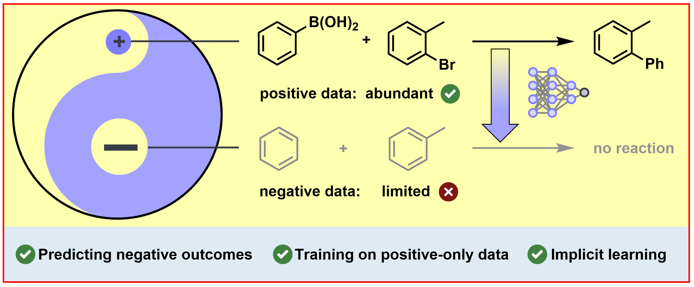

# Nick Wierich

PhD student in chemistry at the University of Münster ([Glorius group](https://www.uni-muenster.de/Chemie.oc/glorius/)), working on machine learning for organic chemistry and lab automation.

## TACIT

**TAckling Chemistry through ImpliciT negative learning.** A reaction outcome model that learns to separate productive from failed reactions while training on positive-only data.

[Code](https://github.com/GloriusGroup/tacit) · [Paper](https://doi.org/10.26434/chemrxiv.15011216/v1) · [Project page](https://gloriusgroup.github.io/tacit/)

## Contact

[LinkedIn](https://www.linkedin.com/in/nick-wierich)
